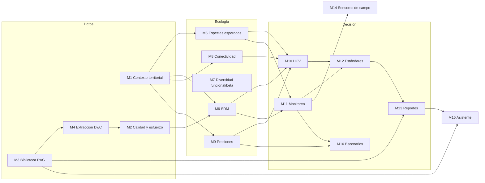

# Hoja de ruta de módulos: Biodiversity Intelligence

**Propósito.** Catálogo de módulos candidatos para investigar, priorizar y desarrollar. El objetivo es que la plataforma pase de *describir* la biodiversidad registrada a *apoyar decisiones*: presencia probable de especies, identificación preliminar de Altos Valores de Conservación (HCV), diseño de monitoreo, reportes para proyectos REDD+ e IA para incorporar documentos.

**Cómo leer cada módulo.** Cada ficha tiene:

- **Objetivo**: qué resuelve.
- **Respaldo**: método o estándar que lo sustenta.
- **Alcance**: funcionalidades.
- **Insumos**: datos que necesita.
- **Entregables**.
- **Encaje en la arquitectura**: cómo entra en el código actual.
- **Riesgos**.
- **Validación**: cómo saber que funciona.
- **Esfuerzo**: S ≈ 1–2 semanas · M ≈ 3–6 · L ≈ 2–4 meses, para una persona con experiencia.

> **Nota sobre las referencias.** Las citas son a métodos, estándares y fuentes ampliamente usados. Antes de implementar, verifica la versión vigente de cada estándar (Verra, CCB, HCVN, TNFD) y las condiciones de licencia de cada fuente de datos: cambian con frecuencia (CARTO, por ejemplo, pasó a exigir API key).

---

## 1. Punto de partida

| Ya existe | Detalle |
|---|---|
| Ingesta por área de interés | GBIF (API, descarga con DOI, ZIP), recorte con DuckDB Spatial |
| Enriquecimiento | Res. 0126/2024, IUCN (vía GBIF o API v4), Catálogo SiB (nombres, CITES, exóticas, textos) |
| Elevación | Copernicus DEM GLO-30, con opción de raster local |
| Indicadores | Calidad, composición, geografía, gradiente altitudinal, temporal, incertidumbre, taxonomía, amenaza, grilla, diversidad (Hill, Chao, rarefacción), índice de peligro, hotspots Gi*, perfiles por especie (AOO/EOO), evidencia × amenaza |
| Visualización | Mapa 3D con KDE de avistamientos, análisis por pestañas, catálogo y fichas, exportes GIS |
| Extensibilidad | Indicadores enchufables (`@register`), paneles registrables, workspaces por área |

**Brechas principales.**

1. Solo usa **registros observados**: no estima qué especies *probablemente* están presentes ni dónde.
2. No integra **capas ambientales ni de presión** (coberturas, deforestación, ecosistemas, áreas protegidas, KBA).
3. No incorpora **conocimiento no estructurado**: EIA, planes de manejo, literatura, informes de campo.
4. No produce **entregables normativos**: HCV, plan de monitoreo, anexos para estándares de carbono y biodiversidad.
5. Es monousuario, sin auditoría ni versionado de análisis.

---

## 2. Principios transversales (aplican a todos los módulos)

1. **Trazabilidad de cada cifra.** Todo resultado guarda fuente, versión del dato, fecha de acceso, parámetros y versión del código (*data lineage*). Sin esto, ningún reporte resiste auditoría.
2. **Humano en el lazo para todo lo generado por IA.** La IA propone y un especialista valida. Las salidas de IA se marcan visualmente y nunca alimentan indicadores oficiales sin aprobación.
3. **Separar evidencia, inferencia y juicio experto.** Ejemplos: "registro verificado" ≠ "presencia modelada" ≠ "presencia esperada según rango"; "HCV probable" ≠ "HCV confirmado".
4. **Datos sensibles.** Generalizar las coordenadas de especies amenazadas o con presión de tráfico en las salidas públicas (Chapman, 2020).
5. **Licencias.** Respetar CC-BY / CC-BY-NC de GBIF y SiB, y citar el DOI de cada descarga.
6. **Sesgo de muestreo explícito.** Todo producto espacial muestra el esfuerzo de muestreo junto al resultado.
7. **Reproducibilidad.** Cada análisis se puede re-ejecutar desde su configuración: semillas fijas, entornos fijados.

---

## 3. Mapa de módulos

| # | Módulo | Bloque | Valor | Innovación | Respaldo | Esfuerzo | Depende de |
|---|---|---|---|---|---|---|---|
| M1 | Contexto territorial (capas ambientales y de presión) | Datos | ★★★★★ | ★★ | ★★★★★ | M | — |
| M2 | Calidad avanzada y esfuerzo de muestreo | Datos | ★★★★ | ★★ | ★★★★★ | S | — |
| M3 | Biblioteca de evidencia con IA (RAG documental) | IA | ★★★★★ | ★★★★★ | ★★★★ | L | — |
| M4 | Extracción asistida de registros a Darwin Core | IA | ★★★★ | ★★★★ | ★★★ | M | M3 |
| M5 | Especies esperadas y brecha de inventario | Ecología | ★★★★★ | ★★★ | ★★★★★ | M | M1 |
| M6 | Modelos de distribución de especies (SDM) | Ecología | ★★★★★ | ★★★ | ★★★★★ | L | M1, M2 |
| M7 | Diversidad funcional, filogenética y beta | Ecología | ★★★ | ★★★ | ★★★★★ | M | — |
| M8 | Conectividad y fragmentación | Ecología | ★★★★ | ★★★ | ★★★★★ | M | M1 |
| M9 | Presiones y amenazas (alertas de deforestación) | Ecología | ★★★★★ | ★★★ | ★★★★★ | M | M1 |
| M10 | Pre-identificación de HCV 1–6 | Decisión | ★★★★★ | ★★★★ | ★★★★★ | L | M1, M5, M6, M8, M9 |
| M11 | Diseñador de monitoreo preliminar | Decisión | ★★★★★ | ★★★★ | ★★★★★ | L | M5, M6 |
| M12 | Alineación con estándares (REDD+, CCB, TNFD, GBF) | Decisión | ★★★★ | ★★★ | ★★★★★ | M | M10, M11 |
| M13 | Generador de reportes con IA | Decisión | ★★★★★ | ★★★★ | ★★★★ | M | M3, M12 |
| M14 | Cámaras trampa, bioacústica y ADN ambiental | Campo | ★★★★ | ★★★★★ | ★★★★ | L | M11 |
| M15 | Asistente conversacional con herramientas (agente) | IA | ★★★★ | ★★★★★ | ★★★ | M | M3, M13 |
| M16 | Escenarios, línea base y adicionalidad (BACI) | Decisión | ★★★★ | ★★★ | ★★★★ | M | M9, M11 |
| M17 | Plataforma: multiusuario, auditoría, colas, API pública | Plataforma | ★★★★ | ★★ | ★★★★★ | L | — |



---

## 4. Fichas de los módulos

### M1. Contexto territorial: capas ambientales y de presión

**Objetivo.** Caracterizar el área con capas oficiales y globales, y dejarlas listas como covariables para SDM, HCV, conectividad y monitoreo.

**Respaldo.** Las variables bioclimáticas, de cobertura y de ecosistemas son los predictores estándar de distribución (Elith & Leathwick, 2009). El *Mapa de Ecosistemas Continentales, Costeros y Marinos de Colombia* (IDEAM et al., 2017) y la *Lista Roja de Ecosistemas* (Etter et al., 2017) son la referencia nacional para HCV 3.

**Alcance.**

| Capa | Fuente candidata | Uso |
|---|---|---|
| Clima (19 bioclimáticas, escenarios futuros) | CHELSA (Karger et al., 2017) o WorldClim 2 (Fick & Hijmans, 2017) | SDM, vulnerabilidad climática |
| Topografía (pendiente, rugosidad, TWI) | Derivadas del DEM GLO-30 ya integrado | SDM, HCV 4 (erosión) |
| Cobertura y uso | MapBiomas Colombia (serie anual), ESA WorldCover 10 m, Corine Land Cover Colombia (IDEAM) | SDM, fragmentación, HCV 2/3 |
| Pérdida de bosque | Hansen et al. (2013) Global Forest Change; cifras oficiales del SMByC (IDEAM) | Presiones, REDD+ |
| Ecosistemas y su amenaza | Mapa de ecosistemas IDEAM 2017; Lista Roja de Ecosistemas (Etter et al., 2017) | HCV 3 |
| Áreas protegidas | RUNAP (Parques Nacionales Naturales); WDPA / Protected Planet | Contexto, HCV 1–2 |
| Áreas Clave para la Biodiversidad | KBA (IUCN, 2016) | HCV 1 |
| Paisajes forestales intactos e integridad | IFL (Potapov et al., 2017); FLII (Grantham et al., 2020) | HCV 2 |
| Hidrografía y cuencas | IGAC / IDEAM (zonificación hidrográfica), HydroSHEDS | HCV 4 |
| Suelos | SoilGrids 250 m | SDM, HCV 4 |
| Territorios étnicos | Resguardos y consejos comunitarios (ANT) | HCV 5–6 (con consulta) |

**Entregables.**

- Pila de rásteres alineada (CRS métrico, resolución común) por workspace: `context/stack.tif` + `context/manifest.json`.
- Indicador `territorial_context`: % del área por ecosistema y su categoría de amenaza, solape con áreas protegidas y KBA, % de bosque y pérdida anual, distancia a vías y ríos.
- Capas conmutables en el mapa 3D.

**Encaje en la arquitectura.**

- Nuevo paquete `src/context/` con un cliente por fuente (patrón `ingestion/*`).
- Reutiliza `spatial/dem.py`, que ya cachea teselas.
- Nuevo paso del pipeline `context` entre `elevation` y `enrich`.
- Lectura de COG remotos vía STAC cuando exista (Copernicus Data Space, AWS Open Data).

**Riesgos.** Volumen de datos (usar COG y ventanas), licencias de cada capa, desfase temporal entre capas.

**Validación.** Las áreas por ecosistema coinciden con un recorte hecho en QGIS (diferencia < 1%). El `manifest.json` documenta fuente, versión y fecha de cada capa.

**Esfuerzo.** M.

---

### M2. Calidad avanzada y esfuerzo de muestreo

**Objetivo.**

- Subir el estándar de limpieza: centroides de país o municipio, capitales, instituciones, coordenadas en el mar, sinónimos.
- Cuantificar el **esfuerzo de muestreo**, que es el confusor número uno de todos los análisis.

**Respaldo.** CoordinateCleaner (Zizka et al., 2019) y sus pruebas estándar. El fondo de grupo objetivo (*target-group background*) para corregir el sesgo en SDM (Phillips et al., 2009). La conciliación taxonómica con el *backbone* de GBIF y el Catalogue of Life.

**Alcance.**

- Pruebas de coordenadas: centroides administrativos, sedes de colecciones, coordenadas en el mar, outliers ambientales (no solo espaciales).
- Conciliación de sinónimos: unificar `acceptedTaxonKey` y marcar los cambios de nombre entre la Res. 0126 y GBIF.
- **Superficie de esfuerzo:** densidad de registros de todos los taxones del grupo, accesibilidad (distancia a vías y ríos) y la KDE que ya existe. Se publica como capa de sesgo.
- Generalización automática de coordenadas sensibles en exportes públicos (Chapman, 2020).

**Entregables.** Indicador `sampling_effort`, flags por registro y exporte "público" generalizado.

**Encaje en la arquitectura.** Se extiende `analytics/quality.py` y se añade `analytics/sampling_effort.py`.

**Validación.** Comparar contra CoordinateCleaner (R) sobre el mismo dataset: concordancia ≥ 95% en registros marcados.

**Esfuerzo.** S.

---

### M3. Biblioteca de evidencia con IA (RAG documental)

**Objetivo.** Incorporar el conocimiento que no está en GBIF y que suele ser decisivo para HCV, monitoreo y reportes:

- estudios de impacto ambiental, planes de manejo de áreas protegidas, POMCA;
- informes de campo, tesis y literatura;
- planes de vida y documentos comunitarios, con permiso.

La idea es poder *preguntarle* a esa evidencia con respuestas **citadas al párrafo**.

**Respaldo.**

- *Retrieval-Augmented Generation* (Lewis et al., 2020): un modelo de lenguaje responde anclado en fragmentos recuperados, lo que reduce las alucinaciones y permite citar.
- La búsqueda híbrida (léxica BM25 + semántica) es la práctica recomendada para corpus técnicos con nombres científicos.
- Para literatura taxonómica existen corpus abiertos: Biodiversity Heritage Library, Plazi TreatmentBank.

**Alcance.**

1. **Ingesta.**
   - Formatos: PDF (con OCR si es escaneado), DOCX y páginas web.
   - Metadatos obligatorios: título, autor, año, tipo de documento, área geográfica y licencia o permiso de uso.
2. **Segmentación inteligente.** Por secciones y tablas. Las tablas de especies se conservan como tablas, no como texto plano.
3. **Indexación híbrida.** BM25 + embeddings, con *re-ranking*. Filtros por área, año, tipo de documento y taxón.
4. **Enlace a entidades.** Cada fragmento se etiqueta con:
   - **taxones** mencionados (resueltos contra el backbone de GBIF);
   - **lugares** (geocodificados al workspace);
   - **amenazas** (vocabulario de amenazas de la IUCN).
5. **Respuestas con cita obligatoria.** Si no hay evidencia, el sistema responde "no encontrado" en lugar de inventar.
6. **Panel de evidencia por especie y por área.** La ficha de especie muestra "Qué dicen los documentos del área", con enlace a la página exacta.

**Arquitectura propuesta.**

```text
docs (PDF/DOCX) → extracción (texto + tablas + OCR) → segmentos con metadatos
   → índice léxico (DuckDB FTS) + índice vectorial (DuckDB VSS o pgvector)
   → recuperación híbrida + re-ranking → LLM con instrucciones de citar → respuesta + citas
```

- Para mantener el stack ligero, DuckDB ya tiene `fts` y `vss`. Migrar a PostgreSQL + pgvector cuando haya multiusuario (M17).
- Usar un modelo de Claude por API para la generación y la extracción estructurada. Los modelos se configuran en `settings.yaml` para poder cambiarlos.
- Los documentos confidenciales no salen del servidor sin autorización explícita. Para clientes sensibles, documentar la política de datos del proveedor del modelo.

**Riesgos.**

- Alucinación. Mitigación: cita obligatoria, verificación automática de que la cita contiene la afirmación, y umbral de confianza.
- Derechos de autor de los documentos, y datos personales en informes.
- Costos de inferencia. Mitigación: caché y modelos pequeños para clasificar.

**Validación.**

- Conjunto de evaluación de unas 100 preguntas con respuesta conocida, armado por un especialista.
- Métricas: exactitud de la respuesta, **fidelidad** (la respuesta se sostiene en la cita) y cobertura de recuperación.
- Meta: fidelidad ≥ 95% y cero respuestas sin cita.

**Esfuerzo.** L.

---

### M4. Extracción asistida de registros a Darwin Core

**Objetivo.** Convertir las listas de especies y tablas de registros de informes y EIA en ocurrencias **Darwin Core** (Wieczorek et al., 2012), etiquetadas como fuente "documental" e integradas al análisis con un nivel de confianza propio.

**Respaldo.** Darwin Core y la Extensión Humboldt (TDWG) para inventarios con esfuerzo. Los LLM con salida estructurada (esquemas JSON) son eficaces extrayendo tablas heterogéneas, *siempre con validación* humana y automática.

**Alcance.**

- Extracción de especie, localidad, coordenadas (incluidas las escritas en grados, minutos y segundos o en MAGNA-SIRGAS), fecha, método, colector y abundancia, si existe.
- Validación automática:
  - el nombre resuelve en GBIF;
  - la coordenada cae dentro del municipio declarado;
  - la fecha es plausible.
- Interfaz de revisión lado a lado (fragmento del PDF ↔ registro propuesto), con aceptar, editar o rechazar.
- Exporte como DwC-A para publicar en el SiB / IPT (devolver datos al sistema nacional).

**Encaje en la arquitectura.** `src/ingestion/documents.py`. Los registros aceptados entran a `occurrences.parquet` con `basisOfRecord=MaterialCitation` y `source=document:{id}`.

**Validación.** Precisión ≥ 95% por campo sobre una muestra revisada manualmente; nunca se incorporan registros no revisados.

**Esfuerzo.** M.

---

### M5. Especies esperadas y brecha de inventario

**Objetivo.** Responder **"¿qué especies deberían estar y no se han registrado?"**. Esto delimita la presencia potencial de otras especies, de forma conservadora y explicable, antes de modelar.

**Respaldo.**

- Mapas de rango de la IUCN Red List (polígonos por especie).
- BioModelos del Instituto Humboldt, distribuciones validadas por expertos para Colombia (Velásquez-Tibatá et al., 2019).
- Map of Life (Jetz et al., 2012).
- Estimadores de completitud y extrapolación de riqueza (Chao et al., 2014; iNEXT: Hsieh et al., 2016). Chao1 y la rarefacción ya existen.

**Alcance.**

- **Lista de especies esperadas:** las especies cuyo rango o modelo experto intersecta el área, filtradas por elevación (ya disponible con DEM), ecosistema (M1) y hábitat (IUCN Habitat Classification).
- **Brecha:** esperadas − registradas, priorizando las amenazadas (Res. 0126 / IUCN), las endémicas y las CITES. Es la lista de "especies a buscar" para el monitoreo (M11).
- **Completitud por grupo:** cobertura de muestra y riqueza extrapolada por clase (aves, mamíferos, anfibios…), con intervalos de confianza.
- **Probabilidad de presencia simple:** combinación de la idoneidad de hábitat y el esfuerzo realizado. Ejemplo: "esperada, hábitat adecuado, alto esfuerzo y nunca registrada" → probablemente ausente o localmente rara.

**Entregables.** Indicador `expected_species`, panel "Especies esperadas no registradas" y filtro en el catálogo ("esperada / registrada / ambas").

**Riesgos.** Los mapas de rango sobrestiman la presencia (comisión) a escala fina; se comunica como presencia *potencial*.

**Validación.** Las especies registradas deberían estar casi todas en la lista esperada (sensibilidad ≥ 90%). Las discrepancias son candidatas a errores de identificación o a extensiones de rango, que es información valiosa.

**Esfuerzo.** M.

---

### M6. Modelos de distribución de especies (SDM)

**Objetivo.** Estimar **dónde** es probable cada especie, sobre todo las amenazadas y focales, dentro del área y su entorno. Alimenta HCV 1, el diseño de muestreo y las alertas.

**Respaldo.**

- MaxEnt (Phillips et al., 2006).
- Modelos de ensamble (biomod2).
- Comparación de desempeño de métodos con datos de solo presencia (Valavi et al., 2022).
- Validación cruzada espacial por bloques (Roberts et al., 2017; blockCV: Valavi et al., 2019).
- Adelgazamiento espacial para reducir sesgo (spThin: Aiello-Lammens et al., 2015).
- Protocolo de reporte **ODMAP** (Zurell et al., 2020).

**Alcance.**

1. **Selección de especies.** Amenazadas, endémicas, focales del proyecto, con un mínimo de registros únicos, típicamente ≥ 15–20 tras adelgazar.
2. **Datos.**
   - Presencias de GBIF + documentales (M4).
   - Fondo de grupo objetivo para corregir el sesgo (M2).
   - Ventana de calibración más amplia que el área (ecorregión), porque solo el área recorta el nicho.
3. **Algoritmos.**
   - Base: MaxEnt (vía `elapid` en Python) y boosted regression trees.
   - Ensamble ponderado por desempeño.
4. **Validación.** Bloques espaciales, AUC, Boyce continuo y TSS. Mapa de **extrapolación** (MESS): dónde el modelo no es confiable.
5. **Salidas.**
   - Idoneidad continua.
   - Mapa binario con umbral documentado.
   - Área idónea dentro y fuera de áreas protegidas.
   - Ficha ODMAP automática.
6. **Clima futuro (opcional).** Proyección con escenarios CHELSA, para planes de conservación de largo plazo.

**Entregables.** Capa de idoneidad por especie en la ficha (sobre el mapa 2D/3D), mapa de riqueza modelada de amenazadas (suma de mapas binarios) y reporte ODMAP en PDF.

**Encaje en la arquitectura.**

- Jobs largos en una cola (M17).
- `src/models/sdm/` con registro de modelos, semillas y métricas.
- Rásteres como COG por workspace.

**Riesgos.**

- Pocas presencias.
- Sesgo de muestreo.
- Sobreajuste.
- Que se lea el resultado como presencia confirmada.

Mitigación: umbrales mínimos de datos, validación espacial y lenguaje explícito ("idoneidad", no "presencia").

**Validación.** TSS o Boyce sobre bloques independientes por encima de un umbral acordado; revisión por un experto del taxón (el mismo principio de BioModelos).

**Esfuerzo.** L.

---

### M7. Diversidad funcional, filogenética y beta

**Objetivo.** Ir más allá del número de especies: qué **funciones** ecológicas están representadas, cuánta **historia evolutiva** contiene el área y cuánto **recambio** hay entre zonas.

**Respaldo.**

- Bases de rasgos:
  - EltonTraits para aves y mamíferos (Wilman et al., 2014);
  - AVONET (Tobias et al., 2022).
- Diversidad filogenética (Faith, 1992).
- Partición de la diversidad beta en recambio y anidamiento (Baselga, 2010).

**Alcance.**

- Gremios tróficos: frugívoros, dispersores y polinizadores, con su presencia y su tendencia.
- Especies con rasgos sensibles: grandes frugívoros y especies de interior de bosque. Sirven como indicadores para el monitoreo.
- PD por celda y beta entre celdas o coberturas: qué zonas aportan especies únicas (insumo para HCV y para priorizar).

**Esfuerzo.** M.

---

### M8. Conectividad y fragmentación

**Objetivo.** Evaluar si el paisaje permite el movimiento de especies e identificar **corredores** y **cuellos de botella**. Es clave para HCV 2 y para diseñar acciones REDD+.

**Respaldo.**

- Teoría de circuitos y la herramienta Circuitscape (McRae et al., 2008).
- Omniscape para conectividad omnidireccional.
- Métricas de paisaje: tamaño de parches, núcleo y borde, distancia entre parches.

**Alcance.**

- Métricas de fragmentación del bosque por año (con M1 y M9).
- Resistencia a partir de la cobertura y las vías.
- Densidad de corriente y corredores prioritarios.
- Conectividad funcional por especie focal, usando la idoneidad de M6 como superficie de resistencia.

**Esfuerzo.** M. Circuitscape tiene implementación en Julia; para casos simples sirve una alternativa en Python (costo mínimo).

---

### M9. Presiones y amenazas

**Objetivo.** Cuantificar las presiones sobre la biodiversidad del área y su evolución, para la gestión y el MRV de REDD+.

**Respaldo.**

- Alertas de pérdida de bosque: GLAD (Hansen et al., 2016) y RADD con radar Sentinel-1 (Reiche et al., 2021).
- Datos oficiales del SMByC (IDEAM).
- Clasificación de amenazas de la IUCN.

**Alcance.**

- **Serie de pérdida de bosque** dentro del área y en un buffer, con tasa anual y comparación con la región de referencia.
- **Alertas recientes** sobre el mapa, cruzadas con la idoneidad de especies amenazadas: "alerta en hábitat de *Inia geoffrensis*".
- **Otras presiones:**
  - incendios (puntos de calor);
  - vías, con distancia a ellas;
  - títulos mineros y otras capas oficiales disponibles;
  - densidad poblacional.
- **Índice de presión por celda** combinable con el índice de peligro actual. Esto corrige su limitación actual: hoy lo domina la abundancia de registros de especies de menor riesgo.

**Esfuerzo.** M.

---

### M10. Pre-identificación de Altos Valores de Conservación (HCV 1–6)

**Objetivo.** Generar una **evaluación preliminar** y trazable de HCV, con evidencia, nivel de confianza y vacíos de información por criterio. Debe reducir el tiempo y costo de una evaluación formal y orientar el trabajo de campo.

> **Límite explícito.** Una evaluación HCV formal requiere evaluadores calificados (por ejemplo, con licencia del *Assessor Licensing Scheme* de la HCV Network), trabajo de campo y **consulta con comunidades**, en especial para HCV 5 y 6. El módulo produce un *pre-screening*, no una certificación.

**Respaldo.**

- *Common Guidance for the Identification of High Conservation Values* (Brown et al., 2013).
- *HCV-HCSA Assessment Manual* (HCVRN & HCSA, 2017).
- *Global Standard for the Identification of KBAs* (IUCN, 2016).
- Lista Roja de Ecosistemas de Colombia (Etter et al., 2017).

**Reglas por criterio (todas configurables en YAML).**

| HCV | Definición (Common Guidance) | Evidencia que la plataforma puede aportar | Señales automáticas (ejemplos) |
|---|---|---|---|
| **HCV 1** | Concentraciones de diversidad biológica, incluidas especies endémicas y especies raras, amenazadas o en peligro, significativas a nivel global, regional o nacional | Registros y SDM de especies CR/EN/VU (Res. 0126, IUCN), endémicas, CITES I; hotspots Gi*; KBA; especies esperadas (M5) | ≥ 1 especie CR/EN con registros recientes o idoneidad alta; solape con KBA; hotspot significativo al 95% de riqueza de amenazadas |
| **HCV 2** | Grandes ecosistemas a nivel de paisaje y mosaicos significativos | IFL / FLII, tamaño de parches de bosque, conectividad (M8) | Parche continuo de bosque por encima de un umbral; FLII alto; corredor regional |
| **HCV 3** | Ecosistemas, hábitats o refugios raros, amenazados o en peligro | Mapa de ecosistemas + Lista Roja de Ecosistemas; ecosistemas con baja representatividad en el SINAP | Ecosistema CR/EN en el área; baja representación en RUNAP |
| **HCV 4** | Servicios ecosistémicos básicos en situaciones críticas (protección de cuencas, control de erosión) | Cuencas abastecedoras, pendientes (DEM), suelos, rondas hídricas | Pendiente alta sobre suelos erodables; nacimientos y bocatomas; cuenca abastecedora de acueducto |
| **HCV 5** | Sitios y recursos fundamentales para satisfacer necesidades básicas de comunidades locales o pueblos indígenas | Solo indicios: territorios étnicos y asentamientos; **requiere consulta** | Marcar "requiere trabajo social"; nunca concluir automáticamente |
| **HCV 6** | Sitios, recursos, hábitats y paisajes de importancia cultural, arqueológica o histórica | Solo indicios: documentos (M3) y registros oficiales; **requiere consulta** | Ídem |

**Alcance.**

- Motor de reglas con **niveles de evidencia**: *presente (alta confianza)*, *probable*, *posible*, *sin información*. Cada conclusión enlaza sus evidencias (registros, capas, documentos de M3).
- **Mapa preliminar de áreas HCV** y **zonas de manejo** sugeridas (núcleo y amortiguación), con su justificación.
- **Lista de vacíos:** qué falta verificar en campo y con qué método. Alimenta M11.
- **Directrices de manejo** por HCV, como plantilla basada en la guía de la HCVN y editable por el especialista.

**Entregables.** Informe preliminar HCV (M13), capa GIS de áreas HCV probables y matriz criterio × evidencia × confianza.

**Validación.** Comparar con 2 o 3 evaluaciones HCV reales ya publicadas de la región. Medir concordancia por criterio y ajustar umbrales.

**Esfuerzo.** L.

---

### M11. Diseñador de monitoreo preliminar

**Objetivo.** Proponer un plan de monitoreo de biodiversidad defendible: **qué** medir (indicadores), **dónde** (diseño espacial), **cómo** (métodos por grupo), **cuánto** esfuerzo y **con qué capacidad estadística** detectar cambios.

**Respaldo.**

- *Essential Biodiversity Variables* (Pereira et al., 2013).
- Modelos de ocupación con detección imperfecta (MacKenzie et al., 2002).
- Muestreo espacialmente balanceado GRTS (Stevens & Olsen, 2004).
- Análisis de potencia estadística para detectar tendencias.
- *Manual de métodos para el desarrollo de inventarios de biodiversidad* (Villarreal et al., 2004, Instituto Humboldt).
- Requisitos de monitoreo de biodiversidad de los CCB Standards.

**Alcance.**

1. **Selección de objetos de monitoreo** (con justificación):
   - especies amenazadas (M5/M6);
   - especies indicadoras y gremios sensibles (M7);
   - HCV identificados (M10);
   - presiones (M9).
2. **Indicadores** vinculados a EBVs y a los objetivos del proyecto. Por ejemplo:
   - ocupación de especies focales;
   - riqueza de aves de interior de bosque;
   - pérdida de bosque en zonas HCV.
3. **Diseño espacial:**
   - estratificación por cobertura, ecosistema, presión y accesibilidad;
   - selección GRTS de sitios, con sobremuestra para reemplazos;
   - verificación de distancia mínima entre sitios (independencia) y accesibilidad (distancia a vías y ríos, pendiente).
4. **Métodos por grupo:**
   - cámaras trampa para mamíferos medianos y grandes;
   - grabadoras acústicas para aves y anuros;
   - transectos y puntos de conteo;
   - ADN ambiental en cuerpos de agua.

   Cada método lleva parámetros de referencia: días-cámara y horas de grabación.
5. **Esfuerzo y potencia:**
   - curvas de rarefacción y extrapolación para el esfuerzo de inventario;
   - simulación de potencia para ocupación (número de sitios × visitas × probabilidad de detección) frente al cambio mínimo detectable.
6. **Calendario y presupuesto** preliminares: temporadas según la estacionalidad (ya calculada) y costos parametrizables.
7. **Protocolo de datos:** plantillas Darwin Core / Extensión Humboldt para que los resultados vuelvan a la plataforma (M14) y puedan publicarse en el SiB.

**Entregables.**

- Plan de monitoreo preliminar (documento).
- Capa de sitios propuestos (GPKG / KML para el GPS de campo).
- Hojas de campo.
- Tabla de potencia estadística.

**Validación.** Revisión por un ecólogo de campo. La simulación de potencia se reproduce con `unmarked` (R) o un paquete equivalente.

**Esfuerzo.** L.

---

### M12. Alineación con estándares y marcos (REDD+, naturaleza y divulgación)

**Objetivo.** Traducir los resultados a los requisitos de los estándares que usan los proyectos y sus compradores, con **listas de chequeo** y evidencias enlazadas.

**Respaldo y alcance.**

| Marco | Qué se mapea |
|---|---|
| **CCB Standards** (CCBA / Verra, v3.1) | Sección de biodiversidad: condiciones sin proyecto, impactos netos, impactos fuera del sitio, monitoreo; HCV; criterio Gold Level de beneficios excepcionales de biodiversidad (especies amenazadas) |
| **VCS / metodologías REDD+ de Verra** | Coherencia de las áreas de referencia y de fuga con las presiones (M9). Verificar la metodología vigente (p. ej. VM0048) |
| **Colombia** | Resolución 1447 de 2018 (sistema MRV y registro RENARE); salvaguardas REDD+; uso de cifras oficiales del SMByC |
| **TNFD** (2023) | Enfoque LEAP: Locate (M1), Evaluate (M9), Assess (M10/M16), Prepare (M13) |
| **Marco Mundial de Biodiversidad Kunming-Montreal** (CBD, 2022) | Contribución a las metas (p. ej. Meta 3 "30×30", Meta 4 especies) e indicadores del marco de monitoreo |
| **Créditos y certificados de naturaleza** | Requisitos emergentes de métricas de biodiversidad (marco Nature de Verra SD VISta, Plan Vivo PV Nature). Verificar el estado y la versión vigente |

**Entregables.** Lista de chequeo por estándar con estado (cumple / parcial / falta) y enlace a la evidencia, más un anexo exportable.

**Esfuerzo.** M. La lógica es simple; el trabajo está en curar los requisitos y mantenerlos actualizados.

---

### M13. Generador de reportes con IA

**Objetivo.** Producir reportes profesionales y reproducibles en minutos:

- **ejecutivo** (2–4 páginas);
- **técnico** (todos los indicadores con método);
- **anexos** de cumplimiento (M12), HCV preliminar (M10) y plan de monitoreo (M11).

**Respaldo.** Reportes reproducibles generados desde los datos (paradigma Quarto / R Markdown). Uso de LLM **restringido a redactar sobre cifras ya calculadas**: el modelo no calcula, solo narra lo que recibe.

**Alcance.**

- Plantillas por tipo de reporte e idioma (es / en), con identidad del cliente.
- Cifras y figuras insertadas desde `analysis.json`: nunca escritas por el modelo.
- Narrativa asistida por IA a partir de las interpretaciones automáticas que ya existen y de la evidencia de M3, con **citas**.
- **Verificación automática de cifras:** cada número del texto debe coincidir con un valor del análisis; si no coincide, se marca.
- Exporte a DOCX / PDF y paquete reproducible (configuración + DOI de GBIF + versiones).
- Sección fija de limitaciones (GBIF ≠ abundancia, sesgo de muestreo, alcance preliminar del HCV).

**Validación.** Cero cifras no trazables; revisión editorial de un especialista antes de publicar.

**Esfuerzo.** M.

---

### M14. Cámaras trampa, bioacústica y ADN ambiental

**Objetivo.** Cerrar el ciclo con datos de **monitoreo propio** (resultado de M11), que tienen esfuerzo conocido y permiten estimar ocupación y tendencias reales.

**Respaldo.**

- **MegaDetector** (Beery et al., 2019) para filtrar fotos vacías y detectar animales, personas y vehículos.
- Clasificadores de especies como SpeciesNet (Google, código abierto), usados en Wildlife Insights.
- **BirdNET** (Kahl et al., 2021) para identificar aves en audio.
- Metabarcoding de ADN ambiental: los resultados llegan como tablas de laboratorio.

**Alcance.**

- Ingesta de lotes de fotos y audio con metadatos (sitio, fecha, equipo).
- Inferencia con validación humana por muestreo; umbrales de confianza por especie.
- Historias de detección por sitio para modelos de ocupación (M11).
- Índices acústicos del paisaje sonoro como indicador complementario.
- Detección de **personas y vehículos** como indicador de presión (con cuidado legal y de privacidad).

**Esfuerzo.** L. Requiere GPU o servicio externo para volúmenes grandes.

---

### M15. Asistente conversacional con herramientas (agente)

**Objetivo.** Permitir preguntas en lenguaje natural sobre el área, respondidas **ejecutando** consultas reales, no recordando datos. Por ejemplo:

- "¿Qué especies amenazadas se registraron cerca del río Guaviare desde 2022?"
- "Compara la estacionalidad de anfibios entre 2021 y 2025."
- "Redacta el párrafo de HCV 1 con sus fuentes."

**Respaldo.** Agentes con llamadas a herramientas (*tool use*) sobre APIs deterministas. El Model Context Protocol (MCP) sirve para exponer las herramientas de la plataforma a asistentes compatibles.

**Alcance.**

- Herramientas mínimas:
  - consulta de especies, registros, indicadores y capas;
  - búsqueda en la biblioteca (M3);
  - generación de figuras.
- Respuestas con tabla, mapa o enlace a la vista del dashboard ya filtrada.
- Registro de todas las consultas (auditoría).
- Prohibido inventar cifras: toda cifra proviene de una herramienta.

**Esfuerzo.** M, una vez existan M3 y M17.

---

### M16. Escenarios, línea base y adicionalidad

**Objetivo.** Comparar el área del proyecto con **áreas control** y entre periodos, para atribuir cambios de biodiversidad y bosque a la intervención.

**Respaldo.**

- Diseños BACI (antes–después, control–impacto).
- Emparejamiento estadístico (*matching*) de áreas control por covariables: pendiente, distancia a vías, cobertura inicial. Es un enfoque usado en evaluación de impacto de áreas protegidas y REDD+.

**Alcance.**

- Selección asistida de áreas control similares.
- Comparación de indicadores entre periodos (se apoya en el selector de periodo que ya existe).
- Escenarios simples de pérdida de bosque futura con base en la tendencia, y su efecto en el hábitat idóneo de especies amenazadas (M6).

**Esfuerzo.** M.

---

### M17. Plataforma: multiusuario, auditoría, colas y API pública

**Objetivo.** Llevar el producto a uso por equipos y clientes con garantías.

**Alcance.**

- Autenticación y roles (administrador, analista, revisor, lector) y espacios por organización.
- **Cola de trabajos** (por ejemplo, Redis + RQ o Celery) para SDM, OCR y descargas largas; reintentos y progreso.
- Base de datos: PostgreSQL + PostGIS + pgvector para metadatos, usuarios y RAG. DuckDB y Parquet se mantienen para la analítica.
- **Versionado de análisis:** cada ejecución queda inmutable con hash de entradas; comparar versiones.
- Auditoría: quién validó qué, especialmente en M4, M10 y M13.
- API pública documentada (OpenAPI, ya generada por FastAPI) con llaves de acceso y límites de uso.
- Despliegue en contenedores, copias de seguridad y monitoreo de errores.
- Accesibilidad (WCAG 2.2 AA) e internacionalización (es / en).

**Esfuerzo.** L.

---

## 5. Hoja de ruta sugerida

| Fase | Duración orientativa | Módulos | Resultado visible |
|---|---|---|---|
| **0. Cimientos** | 1 mes | M2, M17 (cola de trabajos + versionado básico) | Análisis trazables y jobs largos sin bloquear |
| **1. Contexto y presencia potencial** | 2–3 meses | M1, M5, M9 | "Qué ecosistemas hay, qué presiones existen y qué especies faltan por registrar" |
| **2. IA documental** | 2–3 meses (en paralelo con la fase 1) | M3, M4 | Biblioteca de evidencia citada; registros documentales integrados |
| **3. Decisión** | 3–4 meses | M6, M10, M11, M13 | HCV preliminar, plan de monitoreo y reportes automáticos |
| **4. Cumplimiento y campo** | 3+ meses | M12, M14, M8, M7 | Anexos para estándares y cierre del ciclo con monitoreo propio |
| **5. Experiencia avanzada** | continuo | M15, M16 | Asistente conversacional y escenarios |

**Victorias rápidas (menos de 2 semanas cada una):**

1. Generalización de coordenadas sensibles en exportes (M2).
2. Solape con RUNAP y KBA en el resumen (M1, parcial).
3. Serie de pérdida de bosque de Hansen dentro del área (M9, parcial).
4. Lista de especies esperadas usando solo los rangos IUCN (M5, versión mínima).

---

## 6. Riesgos transversales y mitigación

| Riesgo | Mitigación |
|---|---|
| Alucinaciones o errores de la IA en documentos y reportes | Cita obligatoria, verificación automática de cifras y citas, revisión humana obligatoria, etiquetas "generado por IA" |
| Sobreinterpretación de modelos y HCV preliminares | Lenguaje de incertidumbre estandarizado, mapas de extrapolación, renuncias de responsabilidad en cada salida |
| Sesgo de muestreo confundido con patrones ecológicos | Superficie de esfuerzo (M2) siempre visible; fondo de grupo objetivo en los SDM |
| Exposición de ubicaciones de especies sensibles | Generalización por defecto en salidas públicas; permisos por rol para coordenadas exactas |
| Licencias de datos y derechos de documentos | Registro de licencia por fuente y documento; bloqueos de uso comercial donde aplique (CC-BY-NC) |
| Cambios de estándares y de APIs externas | Requisitos versionados en YAML; monitoreo de fuentes (como ocurrió con CARTO) |
| Datos de comunidades (HCV 5–6) | Consentimiento libre, previo e informado; no inferir automáticamente; acceso restringido |
| Costos de cómputo e inferencia | Caché, jobs programados, modelos pequeños para clasificar, presupuesto por workspace |

---

## 7. Preguntas abiertas para investigar

1. **Umbrales HCV** apropiados para la Orinoquía y la Amazonía colombiana: ¿qué hacen las evaluaciones HCV publicadas en la región?
2. **Acceso a BioModelos y a rangos IUCN** para uso comercial: términos de uso y API disponibles.
3. **Desempeño de los SDM con datos GBIF dominados por observación ciudadana**, que concentran registros en aves cerca de vías. ¿Cuántas especies amenazadas del área alcanzan datos suficientes?
4. **Requisitos vigentes de biodiversidad** en las metodologías REDD+ y en los marcos de créditos de naturaleza que usarán los clientes.
5. **Política de datos con proveedores de IA** para documentos confidenciales de clientes: retención y región de procesamiento.
6. **Capacidad de campo de los clientes:** qué métodos de monitoreo (cámaras, acústica, ADN ambiental) son realistas en costo y logística.

---

## 8. Referencias

- Aiello-Lammens, M. E., et al. (2015). spThin: an R package for spatial thinning of species occurrence records for use in ecological niche models. *Ecography*, 38, 541–545.
- Baselga, A. (2010). Partitioning the turnover and nestedness components of beta diversity. *Global Ecology and Biogeography*, 19, 134–143.
- Beery, S., Morris, D., & Yang, S. (2019). Efficient pipeline for camera trap image review. *arXiv:1907.06772*.
- Brown, E., et al. (Eds.) (2013). *Common Guidance for the Identification of High Conservation Values*. HCV Resource Network.
- CBD (2022). *Kunming-Montreal Global Biodiversity Framework* (Decisión 15/4).
- CCBA / Verra (2017). *Climate, Community & Biodiversity Standards*, v3.1.
- Chao, A., et al. (2014). Rarefaction and extrapolation with Hill numbers. *Ecological Monographs*, 84, 45–67.
- Chapman, A. D. (2020). *Current Best Practices for Generalizing Sensitive Species Occurrence Data*. GBIF Secretariat.
- Elith, J., & Leathwick, J. R. (2009). Species distribution models: ecological explanation and prediction across space and time. *Annual Review of Ecology, Evolution, and Systematics*, 40, 677–697.
- Etter, A., Andrade, A., Saavedra, K., Amaya, P., & Arévalo, P. (2017). *Estado de los ecosistemas colombianos: una aplicación de la metodología de la Lista Roja de Ecosistemas*. Pontificia Universidad Javeriana / Conservación Internacional.
- Faith, D. P. (1992). Conservation evaluation and phylogenetic diversity. *Biological Conservation*, 61, 1–10.
- Fick, S. E., & Hijmans, R. J. (2017). WorldClim 2. *International Journal of Climatology*, 37, 4302–4315.
- Grantham, H. S., et al. (2020). Anthropogenic modification of forests means only 40% of remaining forests have high ecosystem integrity. *Nature Communications*, 11, 5978.
- Hansen, M. C., et al. (2013). High-resolution global maps of 21st-century forest cover change. *Science*, 342, 850–853.
- Hansen, M. C., et al. (2016). Humid tropical forest disturbance alerts using Landsat data. *Environmental Research Letters*, 11, 034008.
- HCVRN & HCSA (2017). *HCV-HCSA Assessment Manual*.
- Hsieh, T. C., Ma, K. H., & Chao, A. (2016). iNEXT: an R package for rarefaction and extrapolation of species diversity. *Methods in Ecology and Evolution*, 7, 1451–1456.
- IDEAM et al. (2017). *Mapa de Ecosistemas Continentales, Costeros y Marinos de Colombia*, escala 1:100.000.
- IUCN (2016). *A Global Standard for the Identification of Key Biodiversity Areas*, v1.0.
- Jetz, W., McPherson, J. M., & Guralnick, R. P. (2012). Integrating biodiversity distribution knowledge: toward a global map of life. *Trends in Ecology & Evolution*, 27, 151–159.
- Kahl, S., et al. (2021). BirdNET: A deep learning solution for avian diversity monitoring. *Ecological Informatics*, 61, 101236.
- Karger, D. N., et al. (2017). Climatologies at high resolution for the earth's land surface areas (CHELSA). *Scientific Data*, 4, 170122.
- Lewis, P., et al. (2020). Retrieval-Augmented Generation for knowledge-intensive NLP tasks. *NeurIPS 33*.
- MacKenzie, D. I., et al. (2002). Estimating site occupancy rates when detection probabilities are less than one. *Ecology*, 83, 2248–2255.
- McRae, B. H., Dickson, B. G., Keitt, T. H., & Shah, V. B. (2008). Using circuit theory to model connectivity in ecology, evolution, and conservation. *Ecology*, 89, 2712–2724.
- MADS (2018). Resolución 1447 de 2018 (sistema MRV y registro de reducción de emisiones RENARE).
- Pereira, H. M., et al. (2013). Essential Biodiversity Variables. *Science*, 339, 277–278.
- Phillips, S. J., Anderson, R. P., & Schapire, R. E. (2006). Maximum entropy modeling of species geographic distributions. *Ecological Modelling*, 190, 231–259.
- Phillips, S. J., et al. (2009). Sample selection bias and presence-only distribution models: implications for background and pseudo-absence data. *Ecological Applications*, 19, 181–197.
- Potapov, P., et al. (2017). The last frontiers of wilderness: tracking loss of intact forest landscapes from 2000 to 2013. *Science Advances*, 3, e1600821.
- Reiche, J., et al. (2021). Forest disturbance alerts for the Congo Basin using Sentinel-1. *Environmental Research Letters*, 16, 024005.
- Roberts, D. R., et al. (2017). Cross-validation strategies for data with temporal, spatial, hierarchical, or phylogenetic structure. *Ecography*, 40, 913–929.
- Stevens, D. L., & Olsen, A. R. (2004). Spatially balanced sampling of natural resources. *Journal of the American Statistical Association*, 99, 262–278.
- TNFD (2023). *Recommendations of the Taskforce on Nature-related Financial Disclosures*.
- Tobias, J. A., et al. (2022). AVONET: morphological, ecological and geographical data for all birds. *Ecology Letters*, 25, 581–597.
- Valavi, R., et al. (2019). blockCV: an R package for generating spatially or environmentally separated folds for k-fold cross-validation of species distribution models. *Methods in Ecology and Evolution*, 10, 225–232.
- Valavi, R., Guillera-Arroita, G., Lahoz-Monfort, J. J., & Elith, J. (2022). Predictive performance of presence-only species distribution models: a benchmark study with reproducible code. *Ecological Monographs*, 92, e01486.
- Velásquez-Tibatá, J., et al. (2019). BioModelos: A collaborative online system to map species distributions. *PLOS ONE*, 14, e0214522.
- Villarreal, H., et al. (2004). *Manual de métodos para el desarrollo de inventarios de biodiversidad*. Instituto de Investigación de Recursos Biológicos Alexander von Humboldt.
- Wieczorek, J., et al. (2012). Darwin Core: an evolving community-developed biodiversity data standard. *PLOS ONE*, 7, e29715.
- Wilman, H., et al. (2014). EltonTraits 1.0: species-level foraging attributes of the world's birds and mammals. *Ecology*, 95, 2027.
- Zizka, A., et al. (2019). CoordinateCleaner: standardized cleaning of occurrence records from biological collection databases. *Methods in Ecology and Evolution*, 10, 744–751.
- Zurell, D., et al. (2020). A standard protocol for reporting species distribution models. *Ecography*, 43, 1261–1277.
